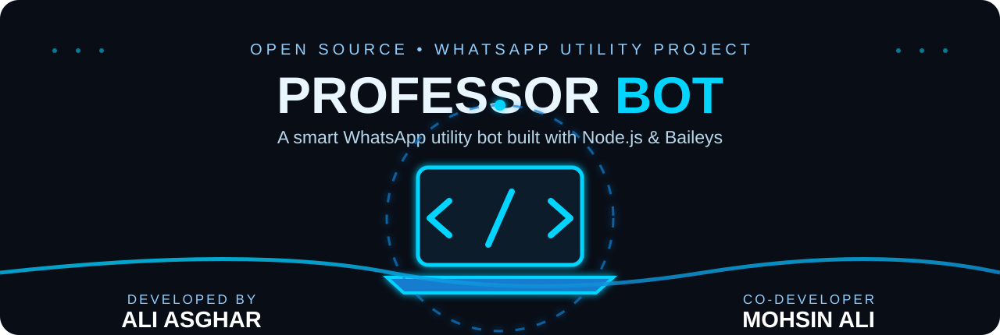

#  PROFESSOR BOT

<p align="center"></p>
<p align="center"><strong>A feature-focused WhatsApp utility bot built with Node.js and Baileys.</strong><br/><em>Status tools · View Once handling · Message recovery attempts · Presence controls</em></p>

<p align="center">


</p>

## 🎨 Official colour scheme — Cyber Blue
| Role | Colour | Hex |
|---|---|---|
| Background | Deep Navy | `#080D16` |
| Primary | Electric Blue | `#147DCE` |
| Accent | Neon Cyan | `#00D4FF` |
| Secondary | Steel Blue | `#26374B` |
| Text | Ice White | `#EAF6FF` |

## ✨ Features
| Feature / Command | Description |
|---|---|
| `.status on/off` | Automatically views incoming statuses and copies supported content to Message Yourself. |
| `.delete on/off` | Attempts to copy deleted messages. Only messages cached while online may be recoverable. |
| Automatic View Once handling | Copies supported incoming View Once media when available in the message payload. |
| `.autovv on/off` | Toggles automatic View Once copying. |
| `.online on/off` | Requests available/unavailable presence. |
| `.typing on/off` | Toggles typing presence indicator. |
| `.recording on/off` | Toggles recording presence indicator. |

> Actual behavior depends on WhatsApp/Baileys payloads, connectivity, and platform restrictions. Not every item is guaranteed to be accessible.

## 🧰 Requirements
- Node.js 20 or newer
- npm
- WhatsApp account for linked-device pairing

## ⚙️ Installation
```bash
npm install
npm start
```
Scan the QR code with WhatsApp **Linked devices** if pairing is required. Syntax check: `npm run check`.

## 🎮 Commands
Send commands from the linked account itself. Default prefix: `.`.

| Command | Action |
|---|---|
| `.status on/off` | Toggle status handling |
| `.delete on/off` | Toggle deletion-recovery attempts |
| `.autovv on/off` | Toggle automatic View Once handling |
| `.online on/off` | Toggle requested presence |
| `.typing on/off` | Toggle typing indicator |
| `.recording on/off` | Toggle recording indicator |

## 🔐 Session & privacy
- Keep `auth_info` private and secure.
- Never upload session credentials, pairing secrets, tokens, or private configuration.
- Do not commit personal WhatsApp data or private logs.
- Save or forward media only where you have permission.

## 🛠️ Technology
- [Node.js](https://nodejs.org/)
- [Baileys](https://github.com/WhiskeySockets/Baileys)
- [qrcode](https://www.npmjs.com/package/qrcode) and [qrcode-terminal](https://www.npmjs.com/package/qrcode-terminal)

## 🖼️ Brand assets
- [Logo](assets/logo.svg)
- [GitHub banner](assets/banner.svg)
- [Social preview artwork](assets/social-preview.svg)

## ⚠️ Disclaimer
Independent community project; not affiliated with or endorsed by WhatsApp or Meta. Compatibility may change as WhatsApp/Baileys evolve.

## 👨‍💻 Project Credits

**Created and developed by:**
- Ali Asghar
- Mohsin Ali

> Personal identity details such as CNIC, home address, and private contact information are intentionally not published in this repository.

## 👨‍💻 Creator Profiles

### Ali Asghar — Computer Engineering Student & Developer

A technology-focused Computer Engineering student at **Khwaja Fareed University of Engineering & Information Technology (KFUEIT)**, Rahim Yar Khan, with practical experience in computer operations, digital services, printing, and online documentation.

#### 🎓 Education
- **BS Computer Engineering — KFUEIT** | 2024–Present
  - CGPA: **3.34 / 4.00**
  - Academic focus: Computer Engineering, Computer Systems, and Programming
- **HSSC (ICS) — Superior College** | 2022–2024
  - Score: **64.33%**
- **SSC (Science) — H/S 51/P** | 2020–2022
  - Score: **71.73%**

#### 💼 Practical Experience
**Part-Time Computer & E-Sahulat Services Assistant — Shaheen Photostate, Rahim Yar Khan**

The supplied CV records approximately **3 years of hands-on experience** across:
- NADRA e-Sahulat assistance and CNIC-related service processing
- FRC, Form-B, verification, and Pak ID fee processing
- Vehicle verification, ownership transfer, token tax, and online traffic challan payments
- Photocopying, scanning, colour and black-and-white printing
- CV preparation, business cards, letterheads, and basic graphic design
- Lamination, ID card coating, binding, composing, email, and online applications

#### 🧪 Academic & Development Projects
- **Footstep Power Generating System (2024):** Footstep-based energy harvesting and electrical generation.
- **Touch Sensor Circuit (2024):** Touch-sensitive circuit analysis and switching implementation.
- **Islamic Quiz Mobile Application (2025):** Interactive MCQs, navigation, and score-based assessment.
- **Ali Electric Store Desktop Application (2025):** Product, customer, and store-operation management.
- **Handwritten Digit Recognition Website using CNN (2026):** Image classification and digit prediction.
- **Car Parking & EDC Design (2026):** Parking control logic and hardware interfacing.
- **Shopify E-Commerce Website (2026):** Store layout, product listings, and online shopping functionality.

#### 🏆 Honors & Recognition
- **Prime Minister's Youth Laptop Scheme (2026):** Selected as a laptop recipient at KFUEIT.
- **Dean's Honor Roll — Fall 2024:** Recognition for academic performance in the Faculty of Electrical & Computer Engineering.

#### 🧰 Skills
- Computer operations and digital services
- NADRA e-Sahulat and online documentation
- Printing, scanning, and document processing
- Basic graphic design and CV preparation
- Customer service and online application assistance
- Programming and computer systems fundamentals

#### 🌐 Languages
- Urdu — Mother tongue
- English — Proficiency as stated in the supplied CV

### Mohsin Ali — Project Co-Creator

Mohsin Ali is credited as a co-creator of Professor Bot. Further education, experience, projects, awards, or skills have not been added because a separate verified profile was not included in the supplied CV.

> **Privacy note:** CNIC, date of birth, personal phone number, email address, and home address are intentionally excluded from this public project profile.

## 🔎 Suggested repository topics
`whatsapp-bot`, `baileys`, `nodejs`, `whatsapp-automation`, `status-saver`, `view-once`, `whatsapp-web`.

<p align="center"><strong>PROFESSOR BOT · CYBER BLUE EDITION</strong></p>
